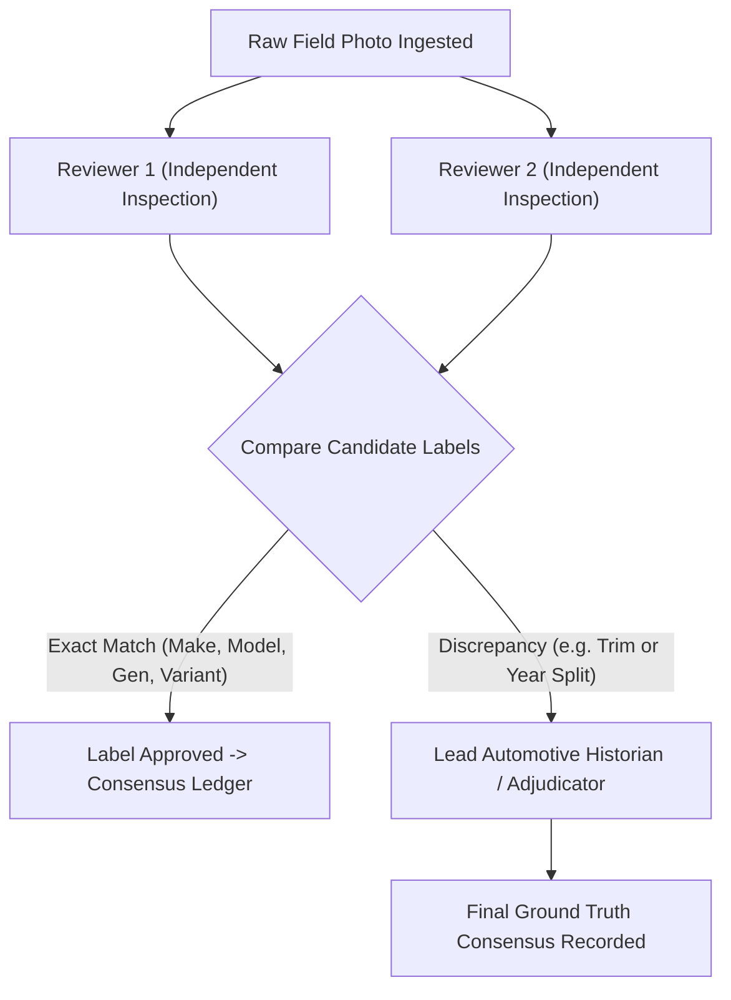

# Field-Photo Collection & Annotation Protocol (Phase 11)

> **Document Status**: Standard Operating Procedure (SOP)  
> **Target Dataset**: Apex Field Evaluation Slice (`eval/field_slice/`)  
> **Target Size**: Minimum $n = 300$ real-world smartphone captures  
> **Gate Dependency**: Subject to Gate G4 approval (Field Photo Collection Authorization)

---

## 1. Objective & Scientific Purpose

The Apex Golden Evaluation Benchmark (`eval/golden/manifest.json`) is composed of high-quality automotive photography and auto show captures. To validate generalization against real-world mobile camera noise, sensor compression, challenging optics, and uncurated environments, a dedicated **Field Photo Slice** is collected.

This slice is permanently held as an independent evaluation partition and is never used for model training, prompt tuning, or gallery indexing.

---

## 2. Capture Diversity Matrix ($n \ge 300$)

Every photo in the field slice must be captured on physical smartphone devices (iOS / Android) across diverse makes and camera sensors. The collection must satisfy the following distribution constraints:

| Environmental Condition | Minimum Samples | Target % | Criteria & Description |
|---|---|---|---|
| **Low Light / Night** | 60 | 20% | Streetlights, parking garages, evening dusk, ISO noise, headlight glare |
| **Rain / Wet / Fog** | 45 | 15% | Active rainfall, water droplets on bodywork, wet asphalt reflections, overcast fog |
| **Partial Occlusion** | 60 | 20% | Obscured by roadside foliage, bollards, guard rails, adjacent vehicles ($\ge 15\%$ surface occluded) |
| **Odd / Extreme Angles** | 75 | 25% | Low-angle front lip, steep top-down balcony shot, direct rear fascia, side profile cropped, bad framing |
| **Direct Sun / Flare** | 30 | 10% | Harsh solar glare, lens flares, underexposed high-contrast shadows |
| **Nominal Daylight** | 30 | 10% | Clear daylight baseline controls |
| **Total** | **300** | **100%** | |

---

## 3. Legal, Consent & Privacy Compliance (Gate G2 & Privacy Invariants)

1. **Spotter Consent**:
   - Every contributor signs or digitally accepts the Apex Contributor License Agreement (`apex_contributor_cla_v1`).
   - Photos must be taken from public vantage points (public roads, parking lots, car meets).
2. **Automated & Manual De-Identification**:
   - **License Plates**: All readable alphanumeric plate characters are blurred prior to storage.
   - **Faces**: All human faces (drivers, passengers, pedestrians) are permanently obscured.
   - **EXIF Geolocation**: GPS coordinates and camera serial numbers are stripped during ingestion.

---

## 4. Dual-Reviewer Consensus Labeling Protocol

To eliminate labeling error and subjective annotation bias, every image undergoes independent dual review:



### Protocol Rules:
1. **Blind Annotation**: Reviewer 1 and Reviewer 2 annotate without visibility into each other's labels or model predictions.
2. **Label Granularity**: Reviewers must record:
   - Canonical Make (e.g. `Ferrari`)
   - Model Family (e.g. `488`)
   - Generation / Chassis Code (e.g. `F142M`)
   - Exact Variant / Trim (e.g. `GTB` vs `Spider` vs `Pista`)
   - Visible Distinguishing Evidence (e.g. "Exhaust exit location", "Fender badge", "Brake rotor type")
3. **Dispute Resolution**: Disagreements trigger review by the Lead Automotive Historian. If an exact variant cannot be confirmed beyond reasonable doubt from the image, the label is marked `variant: ambiguous` and assigned to `identified_model` evaluation scope.

---

## 5. Storage & Manifest Structure

Field photos and metadata are stored isolated from golden benchmark files:
- Directory: `eval/field_slice/images/`
- Manifest: `eval/field_slice/manifest.json`
- Each record schema:
```json
{
  "field_id": "FIELD_000101",
  "image_path": "eval/field_slice/images/FIELD_000101.jpg",
  "sha256": "3a8b...",
  "device_class": "iOS_iPhone15Pro",
  "conditions": {
    "lighting": "night_streetlamp",
    "weather": "rain_wet",
    "occlusion": "partial_bollard",
    "viewpoint": "rear_three_quarter"
  },
  "ground_truth": {
    "make": "Porsche",
    "model": "911",
    "generation": "992",
    "variant": "GT3 RS",
    "canonical_id": "porsche-911-992-gt3-rs"
  },
  "verification": {
    "reviewer_1": "rev_id_04",
    "reviewer_2": "rev_id_11",
    "adjudicator": null,
    "consensus_date": "2026-10-10"
  }
}
```
