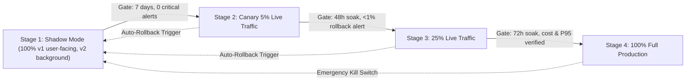

# APEX AI Identification v2 — Phased Rollout Plan & Operational Runbook

> **Document Version**: 2.0.0 (Phase 10 Release Readiness)  
> **Status**: Approved Rollout Architecture  
> **Target System**: Apex Mobile Client, Asynchronous Worker Fleet, and AI Inference Engine

---

## 1. Executive Summary & Rollout Philosophy

The transition from Apex AI v1 (baseline hierarchical classifier) to v2 (retrieval-first, constrained VLM adjudication, calibrated fusion) follows a strict **zero-regressions, fail-closed rollout**. 

At every stage:
- The existing v1 pipeline remains intact and operational as an instant, warm fallback.
- Client responses remain strictly backward-compatible.
- All live traffic is monitored by automated circuit breakers with deterministic rollback thresholds.

---

## 2. Multi-Stage Rollout Progression



### Stage 1: Full Shadow Mode (0% User-Facing / 100% Background Execution)
- **Configuration**: `AI_PIPELINE=shadow`
- **User Experience**: Users receive 100% v1 responses.
- **Worker Behavior**:
  1. Worker executes v1 synchronously and returns the scan result to the client.
  2. Worker asynchronously invokes `v2Pipeline.execute()` with identical image payload.
  3. Disagreements between v1 and v2 are logged to `aiTelemetry` using SHA-256 image hashes only (zero pixel retention without explicit consent).
- **Exit Criteria for Stage 2**:
  - Minimum soak period: 7 calendar days or 5,000 real-world scans.
  - V2 provider failure rate $\le 2.0\%$.
  - P95 v2 latency $\le 4,500\text{ ms}$.
  - Zero critical crashes in worker fleet.

### Stage 2: Canary 5% Traffic
- **Configuration**: `AI_PIPELINE=v2`, `AI_TRAFFIC_SPLIT_PERCENT=5`
- **Routing**: Deterministic hashing of `userId` (`hash(userId) % 100 < 5`).
- **Monitoring Focus**:
  - Live client error rates and unhandled exceptions.
  - User scan feedback ("Suggest Correction" rate).
  - Provider cost consumption per scan ($\le \$0.0025\text{ USD}$ target).
- **Exit Criteria for Stage 3**:
  - Minimum soak period: 48 continuous hours.
  - Wrong-confident report rate $\le 1.0\%$.

### Stage 3: Broad Canary 25% Traffic
- **Configuration**: `AI_TRAFFIC_SPLIT_PERCENT=25`
- **Monitoring Focus**:
  - Quota headroom and concurrency limits on Gemini 3.5 Flash and Cloudflare Workers AI.
  - Stage B in-memory vector search latency under concurrency.
- **Exit Criteria for Stage 4**:
  - Minimum soak period: 72 hours.
  - Daily canary (`scripts/daily_vision_canary.mjs`) passing 100% of runs.

### Stage 4: 100% Production Rollout
- **Configuration**: `AI_PIPELINE=v2`, `AI_TRAFFIC_SPLIT_PERCENT=100`
- **Production State**: V2 handles all vehicle scans globally.
- **Warm Standby**: V1 pipeline code remains loaded in memory for immediate instant rollback if kill switch is triggered.

---

## 3. Automated Rollback Thresholds & Trigger Matrix

The `AiTelemetryManager` sliding monitor automatically issues alerts and triggers rollback if any metric breaches safe operating bounds:

| Metric | Warning Threshold | Critical Rollback Threshold | Automated Mitigation |
|---|---|---|---|
| **Stage C Provider Failure Rate** | $> 2.0\%$ | $> 5.0\%$ over 100 scans | Trip circuit breaker to healthy fallback (`gemini-3.1-flash-lite`); revert to v1 if all fail |
| **Wrong-Confident Disagreement Rate** | $> 1.0\%$ | $> 2.0\%$ over 200 scans | Instant revert to v1 via `AI_PIPELINE=v1` |
| **P95 Total Scan Latency** | $> 5,000\text{ ms}$ | $> 6,500\text{ ms}$ over 50 scans | Disable Pass 2 expensive verification; fall back to decisive retrieval |
| **Single-Scan Cost Ceiling** | $> \$0.0035$ | $> \$0.0050$ | Enforce 1 VLM call limit; reject multi-pass adjudication |
| **HTTP 429 Quota Exhaustion** | 1 instance | 3 instances in 5 min | Halt all retries; open circuit breaker for 60 seconds; alert engineering on-call |

---

## 4. Emergency Kill Switches & Immediate Rollback Runbook

If an operational incident occurs, the on-call engineer can instantly manipulate feature flags without code redeployment:

### Instant Revert to v1 (0 downtime):
```bash
# In Vercel / Cloudflare Environment Settings:
AI_PIPELINE=v1
```
*Effect*: All subsequent scans immediately route through the v1 hierarchical pipeline.

### Disable AI Inference Globally (Maintenance Mode):
```bash
VISION_SCANNING_ENABLED=false
```
*Effect*: Scanner returns HTTP 503 maintenance message ("AI scanner temporarily undergoing scheduled maintenance").

### Disable Gemini Upstream (Route exclusively to Cloudflare/Local):
```bash
GEMINI_SCANNING_ENABLED=false
```
*Effect*: Circuit breaker routes all Stage C adjudication to secondary provider.

---

## 5. Admin AI Control Center Dashboard Feeds

The Admin AI Control Center surface (`/admin/ai/overview`) visualizes live feeds produced by `aiTelemetry.getControlCenterMetrics()`:

1. **Hierarchy Accuracy & Abstention**:
   - `make_only_rate`: Scans where family was identified but trim remained ambiguous.
   - `needs_more_views_rate`: Scans triggering guided recovery for missing angles.
   - `open_set_rate`: Non-catalogue or pedestrian traffic appropriately rejected.
2. **Per-Model Confusion Table**:
   - Live pairwise confusion matrix (e.g., Ferrari 488 vs F8 Tributo, Lamborghini Huracán vs Gallardo).
3. **Stage Latency Waterfall**:
   - Real-time breakdown: Stage A (Quality), Stage B (Retrieval), Stage C (Adjudication), Stage D (Fusion), Stage E (Policy), Stage F (Registry Specs).
4. **Financial Observability**:
   - Running total spend USD, cost per scan, and projected monthly burn.
