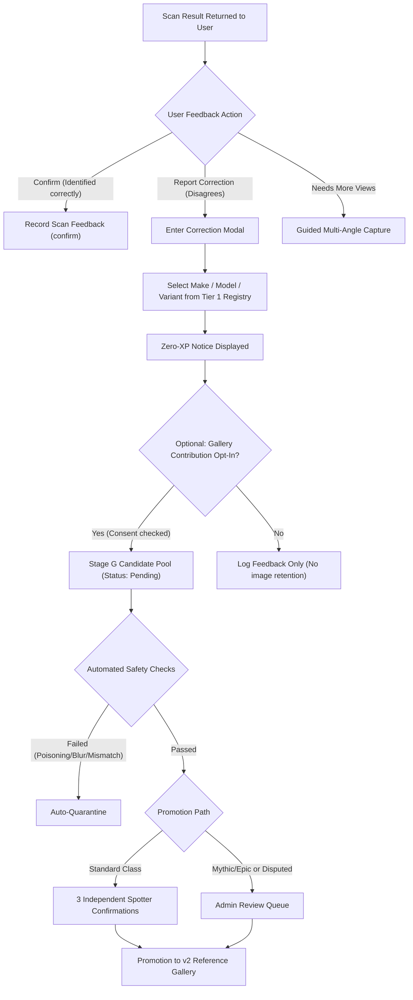

# Stage G AI Flywheel Architecture Design & Operations Specification

> **Document Status**: Proposed Architecture (Phase 9)  
> **Applicability**: Design proposal only. Subject to Gate G2 (User Consent/Licensing) and Gate G3 (Database Migration/Infrastructure). No production tables or database migrations applied.

---

## 1. Executive Summary & Core Objectives

The Stage G Flywheel enables continuous, community-assisted quality improvement of the Apex vehicle identification pipeline while maintaining strict data integrity, anti-poisoning defences, and legal safety.

### Key Pillars:
1. **Explicit Multi-Tier Consent**: Photos only enter reference candidate pools if the spotter explicitly opts in under a perpetual, non-exclusive, attribution-compliant license grant.
2. **Economic & Incentive Integrity (Zero-XP Rule)**: Users never receive XP, badges, streak credit, or collection boosts for submitting corrections or claiming rarer variants. This removes the economic motivation to game or poison the classifier.
3. **Adversarial & Sybil Defense**: Multiple defense layers (pHash deduplication, visual discriminator veto, rate limits, device fingerprinting, and minimum independent spotter thresholds) prevent coordinated poisoning.
4. **Human-in-the-Loop Admin Queue**: Contradictory, high-impact (Rare/Epic/Mythic), or disputed suggestions route to the Admin AI Control Center before ever reaching candidate reference stores.

---

## 2. User Confirmation & Correction Lifecycle

### 2.1 The Scan Confirmation Prompt
Upon scan resolution (`identified` or `identified_model`), the UI displays:
- Primary prediction: Make, Model, Generation, Variant.
- Quick action: "Correct? 👍" or "Suggest Correction ✏️".
- If user confirms: `feedback_type = 'confirm'` is recorded with user ID and scan ID.

### 2.2 Correction Submission Flow
If user clicks "Suggest Correction":
1. **Restricted Search**: The user must select from the canonical Tier 1 Registry (`src/ai-engine/canonical/tier1Registry.json`). Arbitrary freeform string labels are rejected.
2. **Zero-XP Disclosure Banner**:
   > *"Vehicle corrections improve the Apex catalog for everyone. Submitting a correction does not award XP or change your garage rewards."*
3. **Rationale Selection**: The user selects a reason (e.g., "Different Trim/Variant", "Facelift/Pre-facelift", "Wrong Generation").

---

## 3. Consented Gallery Contributions & Licensing (Gate G2)

### 3.1 Consent Terms & Policy Requirements
To contribute an image to the Apex Reference Gallery, the spotter must check an explicit, unbundled toggle:
- *"I own this photograph, there are no identifiable faces or license plates, and I grant Apex a perpetual, royalty-free, worldwide license to use and publish this photo for vehicle recognition and catalog reference."*

### 3.2 Metadata Ingestion Requirements
Every candidate gallery asset records:
- `user_id`: Apex account UUID.
- `scan_id`: Original scan transaction UUID.
- `image_sha256`: Cryptographic hash of the image file.
- `phash`: 64-bit DCT perceptual hash.
- `consent_version`: Semver of the agreed Terms of Service (e.g. `2026.10-v1`).
- `license_tier`: `apex_community_perpetual_v1`.
- `created_at`: UTC timestamp.

---

## 4. Anti-Poisoning & Adversarial Defense Framework

Vehicle classification systems are vulnerable to two classes of attacks:
1. **Vanity Attacks**: A spotter uploads a base BMW 320d and labels it a BMW M3 CS to claim prestige.
2. **Coordinated Poisoning**: A bad actor uploads altered images or subtle variants to degrade competitor accuracy.

### Defense Invariants:
1. **Zero XP / Zero Trophy Reward**:
   - Submissions never trigger unlock achievements, rarity bonuses, or level-ups.
2. **Discriminator Hard Veto**:
   - Every user-proposed correction is checked against Stage D (`discriminator.ts`). If the user suggests "Ferrari 488 Pista" on a photo that Stage D flags as missing the S-Duct hood scoop, the suggestion is immediately rejected with reason `discriminator_contradiction`.
3. **Embedding Centroid Margin Gate**:
   - The candidate image must lie within cosine distance $d \le 0.45$ of the proposed variant's cluster centroid in 64D feature space. Outliers are discarded.
4. **Perceptual Near-Duplicate Sybil Shield**:
   - Suggestions submitted across multiple accounts with Hamming distance $\le 3$ (pHash) are clustered into a single session and count as only 1 vote.
5. **Account Trust Rating**:
   - Only accounts with $\ge 20$ verified scans and account age $> 14$ days may participate in peer promotion voting.

---

## 5. Promotion Rules to Production Gallery

An image in `ai_gallery_contributions` is elevated to `status = 'promoted'` (eligible for gallery ingestion) only if:

| Variant Rarity Tier | Minimum Independent Confirmations | Admin Review Required? |
|---|---|---|
| **Common / Uncommon** | 3 distinct verified users (different devices & IPs) | No (Auto-promoted if no disputes) |
| **Rare** | 5 distinct verified users | No |
| **Epic / Mythic / Exotic** | 5 distinct verified users | **Yes (Mandatory human sign-off)** |
| **Disputed (< 80% consensus)** | N/A | **Yes (Sent to Review Queue)** |

---

## 6. Admin AI Control Center Review Queue

The Admin Review Queue interface (`/admin/ai/review-queue`) provides curators with:
1. Side-by-side comparison:
   - Query image with bounding box.
   - Stage B top candidate reference images.
   - Stage C model adjudication breakdown & confidence.
   - User proposed label & reasoning.
2. Quick Actions:
   - **Approve to Production Gallery**: Flags image as verified community reference.
   - **Accept Correction for Scan Only**: Updates scan history for that user, but excludes image from gallery.
   - **Reject & Blacklist Image**: Quarantines hash from future submissions.
   - **Flag Suspicious User**: Decreases user trust score for deliberate bad-faith submissions.

---

## 7. Rollout Safety & Invariants

- **No live writes during Phase 9**: All code in this proposal is specification and migration scripts only.
- **Gate G2 Block**: Shipped client reference galleries continue to rely strictly on verified Commons assets (`eval/provenance/licenses.csv`) until legal counsel signs off on `apex_community_perpetual_v1`.
- **Gate G3 Block**: Migration scripts remain unapplied in `docs/ai/proposals/`.
