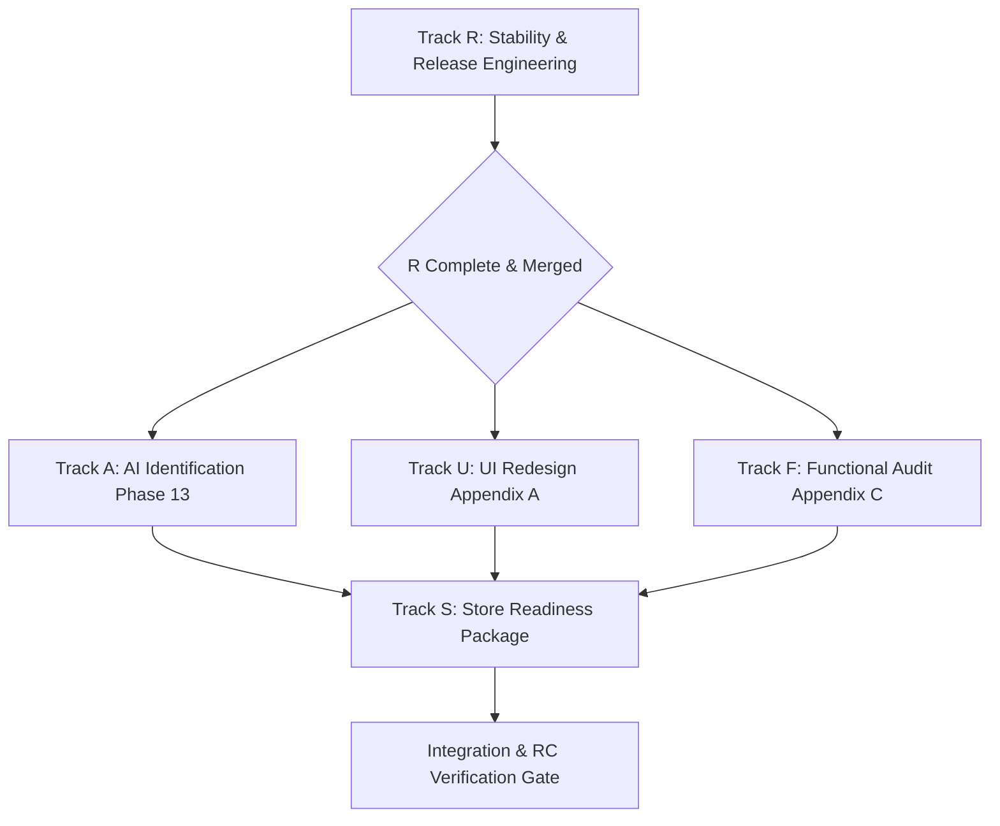

# APEX MASTER PROGRAM — EXECUTION PLAN

**Single Source of Truth**: [docs/APEX_MASTER_PROGRAM.md](file:///c:/Users/DELL/Downloads/Apex-main/Apex-main/docs/APEX_MASTER_PROGRAM.md)  
**Status**: ACTIVE  
**Date**: October 2026  

---

## 1. Overview & Program Architecture

The program takes APEX from its current state (recent recovery from a bootloader bare-import crash and preliminary AI rescue) to a rock-solid, production-ready, beautiful, and verifiable Release Candidate.

The program consists of 5 tracks executed with strict lane boundaries:
1. **Track R (Stability & Release Engineering)** — Branch: `fix/stability`
2. **Track A (AI Identification: Phase 13 & Production Stopgap)** — Branch: `ai/identification`
3. **Track U (UI Redesign: Tokens, Components, Screens)** — Branch: `ui/redesign`
4. **Track F (Functional Audit & Bug-Fix Lane)** — Branch: `fix/functional`
5. **Track S (Store Readiness & Compliance)** — Branch: `release/store-readiness`

Followed by **Integration & Final Release Candidate Verification** (Section 8b/8c).

---

## 2. Order of Execution & Dependencies

### Sequence Rationale
1. **Track R FIRST (Non-negotiable)**:
   - Everything else depends on clean bundling without bare specifier leaks or alias stubs, safe bootloaders, automated CI bundle checks, and proper Web Crypto usage.
   - Shared root files (`index.html`, `vite.config.ts`, `src/main.tsx`, `tokens.css`) must be stabilized by Track R so downstream tracks don't encounter merge collisions or false build errors.
2. **Tracks A, U, and F (Sequenced / Isolated)**:
   - **Track A** continues the AI identification rescue (Phase 13: 316-image pool, 3-way baseline, Stage C shortlist anchoring fix, open-set threshold calibration, production stopgap behind flags).
   - **Track U** implements the Appendix A redesign in `src/styles/tokens.css`, `src/components/ui/`, and screen layouts under strict Lane 1 rules (backend, AI engine, and auth frozen).
   - **Track F** conducts the complete end-to-end functional audit (Appendix C), resolving client bugs (Lane 1) and writing proposals for Lane 2 issues (XP curve, quest mismatch, block user).
3. **Track S (Store Readiness)**:
   - Listing package, Data Flow audit, Privacy policy draft, Data Safety worksheet, account deletion page, UGC moderation gap analysis, and real app screenshot capture.
4. **Integration & Final Verification**:
   - Merge sequence: R $\rightarrow$ A (flagged) $\rightarrow$ U $\rightarrow$ F $\rightarrow$ S.
   - Run end-to-end test suite, bundle verification, emulator & physical device boot checks, and produce `docs/program/FINAL_REPORT.md`.

---

## 3. Parallelisation & Isolation Strategy

1. **Per-Track Frozen Paths & Enforcement**:
   - Each track maintains its own frozen-paths specification (`scripts/frozen-paths.<track>.txt`) and runs `scripts/check-frozen.sh` before any commit.
   - Track R freezes auth logic, backend, game logic, and AI algorithms.
   - Track U freezes backend, AI engine, and auth completely.
   - Track A freezes UI presentation, auth, and database schemas.
   - Track F freezes Lane 2 (auth/backend/ledger) and Lane 3 (AI engine).
2. **Change Lane Classification**:
   - **Lane 1 (Client Presentation & Logic)**: Fix directly with unit/regression tests.
   - **Lane 2 (Auth, Backend, RLS, Economy Ledger, XP Curve, Privacy Serverless)**: Read-only. Document reproduction, provide minimal diff proposals in `docs/proposals/`, and wait for owner sign-off.
   - **Lane 3 (AI Pipeline)**: Modified exclusively within Track A.
3. **Commit & Task Cadence**:
   - One commit per task group with descriptive commit messages.
   - Maintain `docs/program/PROGRESS.md` after every single task.
   - Maintain `docs/program/OWNER_DECISIONS.md` for any decision requiring owner sign-off.

---

## 4. Key Risks & Mitigation Matrix

| Risk | Impact | Mitigation Strategy |
| :--- | :---: | :--- |
| **1. Server Module Leakage (`sharp`, `node:crypto`)** | P0 (Crash / Black screen in WebView) | Remove all stub aliases. Restructure imports so client code never imports server AI engine or Node builtins. Enforce `scripts/check-client-bundle.mjs` in CI to fail on bare specifiers or Node calls. |
| **2. Auth Preload Race & Session Drop** | P0 (Users silently logged out on boot) | Replace arbitrary 800ms cutoff with non-destructive splash hold: React mounts splash immediately, auth client stays in loading state until preload completes, with "Taking longer than usual" retry instead of wiping storage. |
| **3. Cloudflare Workers AI Quota / Latency** | P0 (Scans fail in production) | Implement Phase 13F production stopgap: primary `gemini-3.5-flash` with `gemini-3.1-flash-lite` fallback behind config flags, strict timeout bounds, and distinct error codes for client. |
| **4. Open-Set Vehicle Misclassification** | P0 (Everyday cars labeled as supercars) | Phase 13A-13D: 316-image pool baseline, Stage C free-identification prompt before shortlist comparison, explicit "not listed" option, and calibrated open-set threshold. |
| **5. XP Inflation & Economy Distortion** | P1 (Leveling broken in hours) | Track F simulation script modeling level curves against quest rewards; Lane 2 rebalancing proposal without silently tampering with current ledger code. |
| **6. Older Android WebView Compatibility (Tailwind v4)** | P1 (Broken styling on older devices) | Startup WebView version check: detect Chrome < 111, display friendly "Update Android System WebView" guidance instead of broken blank screen. |
| **7. Tile Provider Traffic Ban** | P1 (Map breaks under production load) | Audit current tile provider, evaluate MapTiler / CARTO / Stadia costs, produce costed proposal in `docs/proposals/`. |
| **8. Secret Exposure in Bundles** | P0 (Security breach) | Pre-commit regex scan across all `dist/` and `src/` files for Gemini, Supabase service keys, and Cloudflare tokens. |

---

## 5. Detailed Step-by-Step Milestones

### Phase 1: Track R (Stability & Release Engineering) — Immediate Priority
- **R1**: Clean bundle import graph, remove `sharp`/`crypto` stubs, gate admin tools behind compile-time flags (`VITE_ENABLE_ADMIN`), create `scripts/check-client-bundle.mjs`, audit Web Crypto.
- **R2**: Staged watchdog in `index.html` (calm notice at 7s, recovery at 20s), non-destructive "Clear Cache", WebView < 111 version compatibility check, local boot failure recorder.
- **R3**: Audit `preloadAuthStorage()` behavior under 3s latency; verify session retention; formulate proposal for OAuth exchange timeout.
- **R4**: Document & script signed release AAB/APK Gradle configuration; audit `targetSdk`, permissions, and network security config.
- **R5**: Setup CI workflow running typecheck, lint, bundle validation, tests, and headless boot checks.
- **R6**: Vendor-neutral crash reporting interface; write proposal for crash provider choice (Gate G9).
- **R7**: Measure cold-start time and chunk sizes; code-split Leaflet and heavy components; enforce bundle budget.
- **R8**: Security scan, restrictive CSP, read-only RLS test script across 5 core tables.
- **R9**: Create `docs/program/RUNBOOK.md`.

### Phase 2: Tracks A, U, F
- **Track A**: Phase 13 scope definition, 3-way baseline, Stage C shortlist fix, open-set retrieval calibration, reference data plan, production stopgap (Appendix B).
- **Track U**: Tokens (`tokens.css`), self-hosted fonts (`@fontsource`), core primitives (`<Button>`, `<RarityBadge>`, `<Slab>`, etc.), shell & screen redesigns (Appendix A).
- **Track F**: Functional audit (Appendix C), quest/garage discrepancy investigation, XP inflation curve simulation, report/block gap documentation.

### Phase 3: Track S (Store Readiness)
- S1 Listing package, S2 Data-flow audit & privacy policy, S3 Data Safety worksheet, S4 Account deletion specification, S5 UGC moderation gap list, S6 Screenshots & asset briefs, S7 Release checklist.

### Phase 4: Integration, Smoke Tests & Release Candidate Gate
- Merge branches per Section 8b order.
- Run complete test suite, emulator & device boot verification, cold starts, and write `docs/program/FINAL_REPORT.md`.
