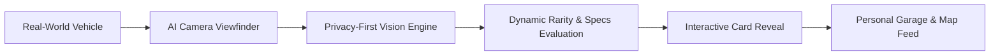
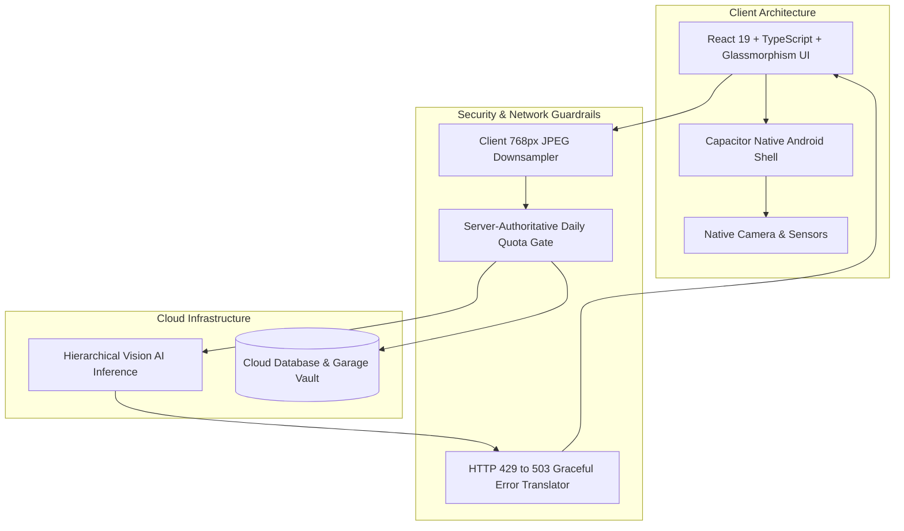

# Apex Private Beta — Shareable Product Walkthrough & Tester Guide

**Document Version:** 1.1 (Sanitized / Public Safe)  
**Distribution:** Beta Testers, Design & Engineering Collaborators, External Partners  
**Status:** Active Private Beta (Android v1.0)  

---

## 1. Executive Summary & Mission

**Apex** is a mobile car-spotting and collector game that turns real-world automotive enthusiasm into an authentic digital collection experience. By spotting a vehicle on the street and capturing a photo through the app, users identify, log, and collect unique vehicle cards into a personal digital garage.

### Core Design Principles
* **Restored Signature Aesthetic:** A high-contrast dark asphalt aesthetic (`#080808`) featuring neon accent lighting, glassmorphic cards, curated typography, and fluid micro-animations.
* **Intelligent Edge-to-Cloud Recognition:** Multi-tiered computer vision trained to identify enthusiast icons, sports cars, supercars, and hypercars with high confidence while rejecting common commuter traffic.
* **Privacy-First Data Safety:** Instant on-device downscaling, zero facial indexing, and zero license plate tracking.
* **Sustainable Fair-Use Economy:** Strict daily quotas and community rate limits ensuring predictable performance on free-tier infrastructure.

---

## 2. Complete User Journey & Screen Walkthrough

### A. Onboarding & Spotter Access
* **Guest Spotter Mode (Recommended for Beta):** Instant 1-tap entry into the app. Immediately generates a local spotter identity, allows unrestricted car scanning, logs vehicles to local storage, and grants full access to the map and garage vault without requiring external credentials.
* **In-App Google Authentication:** Integrated native Credential Manager support for direct account selection. (If Google Play Services returns a temporary configuration notice during private testing, users can seamlessly continue with Guest Spotter or Email).
* **Returning Spotter Progression:** Once onboarded, returning users are immediately routed to their live garage collection without repetitive introductory prompts.

### B. Precision AI Camera Viewfinder
* **Real-Time Camera Controls:** Custom mobile viewfinder with exposure adjustment, shutter haptics, framing reticle, and flash toggle.
* **On-Device Preprocessing:** Photos are downscaled client-side to 768px at 82% JPEG quality before upload, drastically reducing mobile data consumption and latency.
* **Hierarchical Classification Pipeline:**
  1. *Make & Model Identification:* Confirms the core vehicle identity (e.g., `Porsche 911`, `Ferrari 458 Italia`, `Nissan GT-R`).
  2. *Confidence-Gated Trim Verification:* If specific trim packages or generational variants cannot be verified with high certainty ($\ge 70\%$), trim details are omitted, cleanly presenting the verified base model family.
  3. *Commuter Vehicle Filtering:* Standard everyday commuter vehicles (economy hatchbacks, commercial delivery vans) are recognized as *"Uncatalogued / Not in current season"*, maintaining the game's focus on enthusiast vehicles.

### C. Discovery Reveal & Collectible Cards
* **Cinematic Reveal Screen:** Successful vehicle scans trigger an animated card reveal displaying official horsepower, acceleration, engine configuration, and production era.
* **Dynamic Local Rarity Engine:** Rarity badges (*Common, Uncommon, Rare, Epic, Legendary, Exotic*) are calculated dynamically based on regional spotting frequency, giving local sightings personalized collector value.
* **XP Progression & Daily Streaks:** Spotters earn experience points (XP) for every unique discovery, leveling up their Spotter Rank and unlocking custom profile badges.

### D. Digital Garage Vault & Radar Map
* **Collector Garage:** Searchable grid featuring high-resolution photography, vehicle statistics, acquisition timestamps, and badge collections.
* **Dark Glassmorphic Radar Map:** Custom Leaflet-powered radar map with dark tiles showing nearby and worldwide vehicle discoveries. Map attribution is styled with a subtle, non-intrusive dark glassmorphic badge in full compliance with OpenStreetMap terms.
* **Global Activity Feed:** Real-time social stream of verified car spots shared across the spotting community.

---

## 3. Technical Architecture (Sanitized Overview)

### Safety & Cost Guardrails
1. **Single-Action Request Bounds:** A single scan triggers at most 1–2 model inferences with zero unconstrained retry loops.
2. **Strict Daily Quota:** Default fair-use allocation of **10 scans per user per day**.
3. **Graceful Upstream Handling:** Provider capacity limits automatically resolve to friendly status notifications (*"Scanner busy, daily community quota reached"*), avoiding application crashes.
4. **Clean Production Bundling:** Automated bundle hygiene audits eliminate development endpoints, debug stubs, and test fixtures prior to compilation.

---

## 4. Beta Tester Sideload & Onboarding Playbook

### Step 1: Android Installation
1. Download the release package (`Apex-Beta-v1.0.apk`) onto your Android device (Android 7.0+ supported).
2. Tap the downloaded file to begin installation.
3. **Google Play Protect Prompt:**  
   Because this is a private prerelease build installed directly, Android may display:  
   > **"Blocked by Play Protect — Unrecognized app"**  
   * **Action:** Tap **"More details"**, then tap **"Install anyway"**.
4. Grant standard camera and location permissions when prompted to enable real-time spotting.

### Step 2: Spotting & Photography Guidelines
* **Recommended Framing:** Capture vehicles from a clear 3/4 front or 3/4 rear perspective showing headlights, grille, or signature rear styling.
* **Lighting:** Daylight or well-lit environments yield the highest identification accuracy.
* **Privacy First:**
  * Do NOT photograph pedestrians, faces, or clear license plates.
  * Photographs are processed strictly for vehicle recognition and are never used for personal tracking.
* **Target Vehicles:** Sports cars, performance sedans, supercars, hypercars, classic collector cars, and modern enthusiast icons.

### Step 3: Fair-Use Quotas
* Each tester receives **10 scans per day**.
* Daily scan allocations reset at midnight Pacific Time (~12:30 PM IST / 07:00 UTC).
* If you see *"Scanner busy"*, the community quota for the day has been reached.

### Step 4: Submitting Feedback & Bug Reports
If you encounter an issue or an identification mistake, please share:
1. **Photo Used:** The original image of the car.
2. **Expected Vehicle:** The actual Make, Model, and Year.
3. **App Output:** What the scanner returned (or error text).
4. **Device Details:** Android device model and OS version.

---

## 5. Security & Confidentiality Protection Reference

To protect proprietary intellectual property and maintain production security, the following details are strictly omitted from this public walkthrough:

| Protected Category | Sanitization Standard |
| :--- | :--- |
| **API Keys & Cloud Secrets** | Omitted; managed through secure hosting environment variables. |
| **Keystore Passwords & Private Keys** | Scrubbed; stored outside repository on dedicated build hosts. |
| **Database Connection Strings** | Abstracted behind standard authenticated API endpoints. |
| **Proprietary Prompt Directives** | Summarized as hierarchical classification logic. |
| **Local File Paths & User Identifiers** | Replaced with standard generic conventions. |

---

*© 2026 Apex Project. All Rights Reserved. Built for automotive enthusiasts.*
